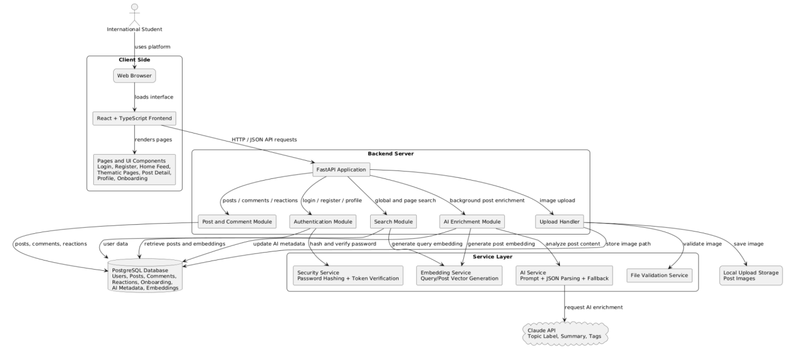
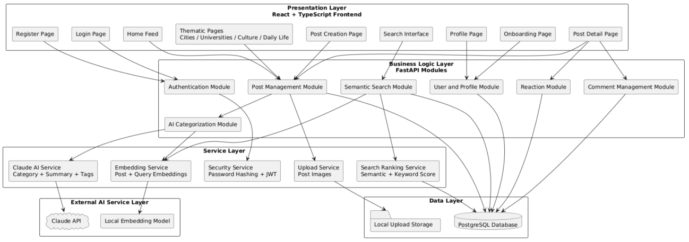
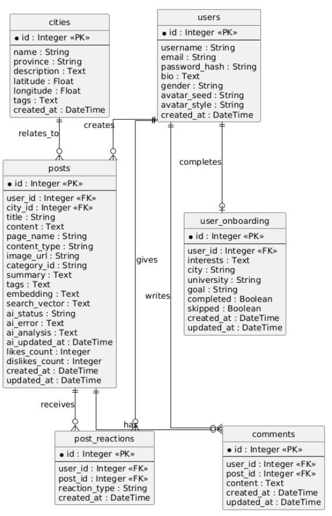

# Huaxia — AI-Driven Semantic Search Community Platform

**A full-stack community platform that turns scattered international-student experiences in China into structured, searchable knowledge.**

**Designed and developed independently by Maroua El Messari**  
**Status:** Working local application · Public deployment in progress


## The problem

International students in China often find essential advice about accommodation, banking, transport, university procedures and cultural adaptation in fragmented WeChat groups, private messages and general social networks. The same questions get asked repeatedly because past answers are difficult to organize and retrieve. Traditional keyword search also misses posts that express the same idea in different words.

**Huaxia combines structured community discussion with AI-assisted metadata and semantic retrieval** so that practical peer knowledge is easier to discover and reuse.

## What I built

I independently designed and implemented the frontend, backend, database, AI integration and evaluation of Huaxia.

- **Student community:** registration, login, profiles, posts, image attachments, comments and reactions.
- **Structured discovery:** dedicated sections for **Cities, Universities, Culture and Daily Life**, plus global and section-specific search.
- **Onboarding:** captures interests, city and university context, and student-life goals to support lightweight personalization.
- **AI post enrichment:** integrates the **Anthropic Claude API** to generate topic labels, summaries and tags for new posts.
- **Hybrid semantic search:** combines sentence embeddings and cosine similarity with keyword relevance, helping users find posts even when wording differs.
- **Failure-tolerant posting:** saves posts before AI enrichment, with fallback metadata if the external AI service fails.

## Product walkthrough

| Landing and account access | Community feed |
| --- | --- |
|  |  |

| Creating a post | Post discussion |
| --- | --- |
|  |  |

### AI enrichment and search


## Architecture

**Frontend:** React, TypeScript, Vite  
**Backend:** Python, FastAPI, SQLAlchemy  
**Database:** PostgreSQL, Alembic migrations  
**AI:** Anthropic Claude API for post enrichment; sentence-transformer embeddings for semantic retrieval  
**Security:** JWT-based authentication and password hashing



The frontend calls FastAPI endpoints for authentication, content, onboarding and search. PostgreSQL persists users, posts, discussions, reactions, AI metadata and embedding data. AI enrichment is handled separately from the initial post-save operation, keeping the community workflow usable if AI processing is unavailable.

### Modules and data model





## How semantic search works

1. The system constructs searchable post text from the title, content, AI summary and tags.
2. A sentence-embedding model represents posts and user queries as vectors.
3. Cosine similarity measures semantic relevance.
4. Keyword relevance is combined with semantic similarity for hybrid ranking.
5. Results are returned globally or filtered to a thematic section.

Unlike a keyword-only search, this approach can surface relevant posts even when the user chooses different phrasing.

## Testing and evaluation

The completed prototype was assessed with functional tests, AI enrichment evaluation, semantic search comparisons, local response-time tests and a small usability study.

| Evaluation | Result |
| --- | --- |
| Functional test cases | 9 listed cases passed |
| AI enrichment | **113 of 114** evaluated posts produced useful enrichment (**99.12%**) |
| Search comparison | Hybrid search performed best or tied for best across the tested queries, measured using **Precision@5** |
| Usability | Preliminary task-based feedback from **5 participants** |

**Interpretation:** The 99.12% figure measures *useful metadata on the evaluated sample*, **not** general-purpose classification accuracy. These results come from a limited local evaluation and do not establish production-scale reliability or performance.

## Run locally

### Prerequisites

- Python and Node.js/npm
- PostgreSQL
- An Anthropic API key for AI enrichment (core community functionality is designed to remain usable if AI enrichment is unavailable)

### Backend

From the repository root:

```bash
python -m venv .venv
# Windows PowerShell:
.venv\Scripts\Activate.ps1
# macOS/Linux:
# source .venv/bin/activate

pip install -r requirements.txt
```

Create `.env` in the repository root using `.env.example` as a template. Set `DATABASE_URL` to your own PostgreSQL database, generate a secure `SECRET_KEY`, and configure `ANTHROPIC_API_KEY` if you want AI enrichment. **Never commit `.env` or real credentials.**

```bash
# After creating the PostgreSQL database:
alembic upgrade head
# The app mounts the local uploads directory; create it if absent.
python -m uvicorn app.main:app --reload
```

Backend API: `http://localhost:8000`  
Interactive API documentation: `http://localhost:8000/docs`

### Frontend

Open a second terminal:

```bash
cd frontend
npm install
npm run dev
```

Frontend development URL: `http://localhost:3000`.

> **Setup note:** Commands reflect the repository's `requirements.txt`, `frontend/package.json`, `app/main.py`, `.env.example`, and Alembic configuration. A clean-machine installation has not been independently executed for this README. Ensure your local PostgreSQL database and `uploads/` directory exist before launching the backend.

## Limitations and future directions

The evaluation used a limited dataset of 114 posts and a small group of testers. Semantic similarity is calculated in the backend, which may not scale to a large corpus. Personalization is lightweight rather than collaborative filtering. Potential extensions include indexed vector search, multilingual retrieval, stronger moderation and larger user studies.

## Project ownership

**Developer:** Maroua El Messari  
**Role:** Sole developer — architecture, frontend, backend, database, AI integration, and testing.

*Screenshots and diagrams document the implemented application.*
